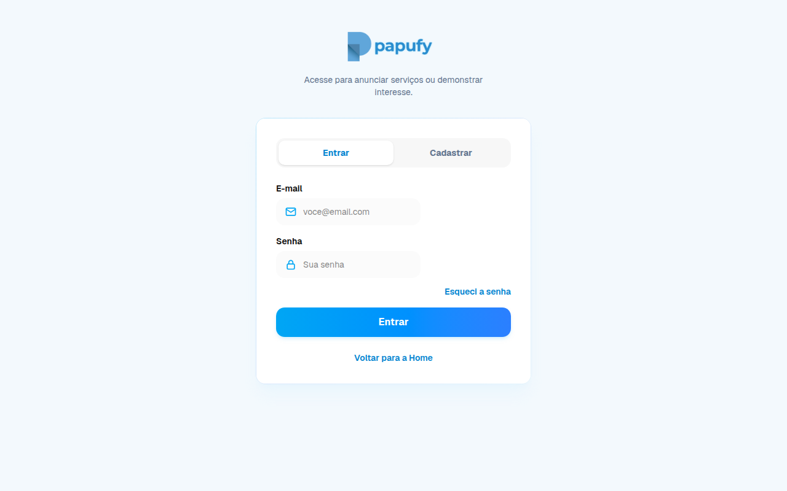

# Papufy Frontend

Interface web do Papufy, um marketplace de serviços e bicos. A pessoa publica um pedido ou um perfil profissional, busca por categoria e cidade, conversa no chat e acompanha carteira, notificações e publicações.

O app é mobile-first, feito em React, TypeScript, Vite e Tailwind. A autenticação, os anúncios e o chat em tempo real dependem de uma API externa.

## O que dá para fazer

- Buscar anúncios e abrir o perfil público de um usuário
- Anunciar um pedido de serviço ou um perfil profissional (eletricista, encanador, diarista, design, aulas e outras categorias)
- Conversar por chat, ver notificações e gerenciar as próprias publicações
- Acessar carteira e perfil autenticados

## Como rodar

```bash
npm install
npm run dev
```

Abra http://localhost:5173.

O servidor de desenvolvimento encaminha `/auth`, `/listings`, `/jobs`, `/chat`, `/payments`, `/geo` e `/ws` para `https://papufy-backend.onrender.com` (a URL já escrita em `.env.example`). O navegador fala só com o Vite: essa API não envia `Access-Control-Allow-Origin` para `http://localhost:5173`. Para outro backend, copie `.env.example` para `.env` e ajuste `VITE_API_URL` (HTTPS, sem localhost).

`npm run build` gera `dist/`. Sem variável de ambiente, a build embute `https://papufy-backend.onrender.com`. Uma `VITE_API_URL` definida na Vercel substitui esse padrão.

## Demo

Não há site público no ar. O endereço `https://papufy-frontend.vercel.app`, que estava neste README e no campo Website do GitHub, responde 404 da Vercel com `DEPLOYMENT_NOT_FOUND`: não existe deployment nesse hostname.

A API em `https://papufy-backend.onrender.com` responde (`GET /health` retorna status ok). As capturas abaixo são da interface local. A home filtra por cidade; em Campina Grande, PB, a API não tinha anúncio nessa consulta.

### Página inicial (desktop)


### Página inicial (celular)


### Entrar



## Publicar de novo na Vercel

O `vercel.json` fixa o framework Vite, o comando `npm run build`, a pasta `dist` e o rewrite de toda rota para `/index.html`. Sem esse rewrite, rotas como `/entrar` e `/anuncio/:id` respondem 404 mesmo com o deploy no ar.

1. Importe este repositório na Vercel. O nome do projeto precisa ser `papufy-frontend` para a URL de produção voltar a ser `https://papufy-frontend.vercel.app`.
2. Em Environment Variables, Production e Preview, se quiser deixar explícito (a build já usa esse padrão quando a variável falta):
   - `VITE_API_URL` = `https://papufy-backend.onrender.com`
   - `VITE_WS_URL` = `wss://papufy-backend.onrender.com/ws`
3. Faça o deploy da branch `main`.
4. No GitHub, About → Website. Esse campo não faz parte do Git. Enquanto não houver deployment, apague `https://papufy-frontend.vercel.app` para o perfil não abrir 404. Quando a Vercel mostrar a URL de Production, coloque essa URL no Website.

Nas respostas conferidas, a API manda `Access-Control-Allow-Origin: https://papufy-frontend.vercel.app` para essa origem e não manda esse cabeçalho para `http://localhost:5173` nem para `https://example.com`. Se o projeto na Vercel ficar em outro hostname, o HTML sobe, mas o navegador bloqueia a API até o backend no Render aceitar a origem nova. Esse backend não está neste repositório.
